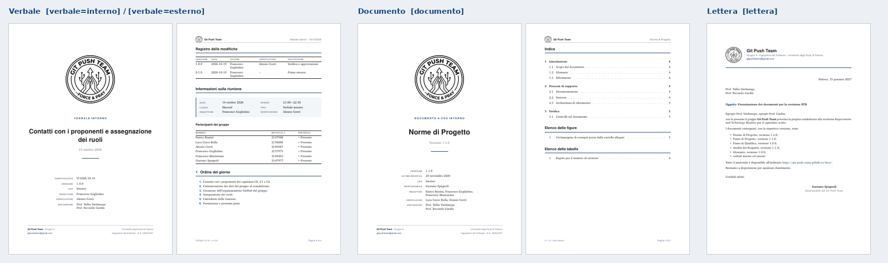

# Guida al repository `docs` — da zero

Questa guida spiega **passo per passo** come scrivere e consegnare i documenti del Git Push Team.
Non serve conoscere LaTeX né Git: seguite le ricette e copiate i comandi così come sono.

> **Come leggere i blocchi di comandi**: le righe in grigio si copiano nel **terminale**
> (in VS Code: menu *Terminale → Nuovo terminale*). Su **Windows** scrivete `python` dove
> qui c'è `python3`. Tutti i comandi si lanciano dalla **cartella principale del repository**
> (quella che contiene `README.md`).

## Indice

0. [Le parole da conoscere](#0-le-parole-da-conoscere)
1. [Prima volta: preparare il computer](#1-prima-volta-preparare-il-computer)
2. [Mappa del repository: cosa si tocca e cosa no](#2-mappa-del-repository-cosa-si-tocca-e-cosa-no)
3. [Il giro completo in 7 passi](#3-il-giro-completo-in-7-passi)
4. [Ricette](#4-ricette)
    - [R1. Scrivere un verbale interno](#r1-scrivere-un-verbale-interno)
    - [R2. Scrivere un verbale esterno](#r2-scrivere-un-verbale-esterno)
    - [R3. Correggere un documento già approvato](#r3-correggere-un-documento-già-approvato)
    - [R4. Creare un documento (Norme, Piani, Analisi…)](#r4-creare-un-documento-norme-piani-analisi)
    - [R5. Dividere un documento lungo in capitoli](#r5-dividere-un-documento-lungo-in-capitoli)
    - [R6. Scrivere una lettera](#r6-scrivere-una-lettera)
    - [R7. Inserire un'immagine](#r7-inserire-unimmagine)
    - [R8. Inserire una tabella](#r8-inserire-una-tabella)
    - [R9. Testo: elenchi, grassetto, link, glossario, note](#r9-testo-elenchi-grassetto-link-glossario-note)
    - [R10. Fare la release di una consegna (RTB, PB)](#r10-fare-la-release-di-una-consegna-rtb-pb)
    - [R11. Cambiare i dati del gruppo](#r11-cambiare-i-dati-del-gruppo)
    - [R12. Verificare il lavoro di un altro (Verificatore)](#r12-verificare-il-lavoro-di-un-altro-verificatore)
5. [Le versioni: la regola semplice](#5-le-versioni-la-regola-semplice)
6. [Prontuario dei comandi](#6-prontuario-dei-comandi)
7. [Quando qualcosa va storto](#7-quando-qualcosa-va-storto)
8. [Impostazioni da fare una volta sola (Amministratori)](#8-impostazioni-da-fare-una-volta-sola-amministratori)
9. [Cosa è cambiato rispetto alla versione precedente](#9-cosa-è-cambiato-rispetto-alla-versione-precedente)

---

## 0. Le parole da conoscere

| Parola | Cosa vuol dire, in pratica |
| --- | --- |
| **Repository** (repo) | La cartella del progetto, salvata su GitHub con tutta la sua storia. |
| **Issue** | Un compito da fare, scritto su GitHub (es. "Scrivere il verbale del 26/10"). Ha un numero: `#12`. |
| **Branch** | Una copia di lavoro separata. Si lavora sempre in un branch, mai direttamente su `main`. |
| **`main`** | Il branch "ufficiale": quello che finisce sul sito. |
| **Commit** | Un salvataggio delle modifiche, con un messaggio che dice cosa avete fatto. |
| **Push** | Mandare i vostri commit su GitHub. |
| **Pull request** (PR) | La richiesta di unire il vostro branch a `main`. Lì il Verificatore controlla. |
| **Merge** | L'unione della PR in `main`. Dopo il merge il sito si aggiorna da solo. |
| **CI** / **Action** | I controlli automatici di GitHub: compilano i PDF e li commentano nella PR. |
| **Chiave** | Il nome breve di una persona usato nei documenti: `guglielmo`, `corro`… (elenco in `template/dati-gruppo.tex`). |
| **Preambolo** | La parte del `.tex` **prima** di `\begin{document}`: lì si scrivono titolo, data, persone, registro. |
| **Registro delle modifiche** | La tabella con tutte le versioni del documento. Si scrive con le righe `\modifica{...}`. |

---

## 1. Prima volta: preparare il computer

Si fa **una volta sola**. Installate, in quest'ordine:

| Programma | Windows | macOS | Linux (Ubuntu/Debian) |
| --- | --- | --- | --- |
| **Git** | [git-scm.com](https://git-scm.com/download/win) (lasciate le opzioni predefinite) | nel terminale: `xcode-select --install` | `sudo apt install git` |
| **Python 3.9+** | [python.org](https://www.python.org/downloads/): spuntate **"Add python.exe to PATH"** | già incluso con il comando qui sopra | già presente (`python3`) |
| **TeX Live** | [TeX Live per Windows](https://tug.org/texlive/windows.html) (`install-tl-windows.exe`) | [MacTeX](https://tug.org/mactex/) | vedi comando qui sotto |
| **VS Code** | [code.visualstudio.com](https://code.visualstudio.com/) | idem | idem |

Su Linux, TeX Live si installa così:

```bash
sudo apt install latexmk texlive-latex-recommended texlive-latex-extra texlive-fonts-recommended texlive-lang-italian texlive-pictures
```

> ⚠️ Su Windows usate **TeX Live**, non MiKTeX: TeX Live include già Perl, che serve a `latexmk`.
> Se usate MiKTeX dovete installare anche [Strawberry Perl](https://strawberryperl.com/).

**Dite a Git chi siete** (con il vostro nome e la mail del vostro account GitHub):

```bash
git config --global user.name "Nome Cognome"
git config --global user.email "la.vostra@mail.it"
```

**Accesso a GitHub** (serve per fare push):

- **Windows**: niente da fare; la prima volta che fate push si apre il browser per l'accesso.
- **macOS / Linux**: installate [GitHub CLI](https://cli.github.com/) (`brew install gh` oppure `sudo apt install gh`), poi lanciate `gh auth login` e rispondete: *GitHub.com → HTTPS → Yes → Login with a web browser*.

**Scaricate il repository** (crea la cartella `docs` dove vi trovate):

```bash
git clone https://github.com/Git-Push-Team/docs.git
cd docs
```

**Apritelo in VS Code**: *File → Apri cartella…* e scegliete la cartella `docs`.
In basso a destra VS Code propone le **estensioni consigliate**: installatele (la più importante è *LaTeX Workshop*).

**Prova finale**: nel terminale di VS Code scrivete

```bash
python3 scripts/build.py
```

Deve finire con `Fatto: N PDF in site/`. Aprite il file `site/index.html` con il browser: vedete il sito con i PDF. Se funziona, siete pronti. ✅

---

## 2. Mappa del repository: cosa si tocca e cosa no

| Percorso | Cos'è | Si tocca? |
| --- | --- | --- |
| `verbali/interni/` | verbali delle riunioni del gruppo (`VI-AAAA-MM-GG.tex`) | ✅ sì |
| `verbali/esterni/` | verbali degli incontri esterni (`VE-AAAA-MM-GG.tex`) | ✅ sì |
| `documenti/` | Norme, Piani, Analisi, Glossario…: **una cartella per documento** | ✅ sì |
| `lettere/` | lettere di presentazione per RTB e PB | ✅ sì |
| `candidatura/` | documenti della candidatura | ✅ sì |
| `allegati/` | immagini usate nei documenti, in sottocartelle | ✅ sì |
| `template/modelli/` | i file **da copiare** per iniziare un documento | 👀 si copiano, non si modificano |
| `template/esempi/` | esempi completi da guardare quando non sapete come fare una cosa | 👀 solo da guardare |
| `template/dati-gruppo.tex` | nome, email e membri del gruppo | ⚠️ solo Amministratori ([R11](#r11-cambiare-i-dati-del-gruppo)) |
| `template/gpt.cls` | la classe LaTeX: decide l'aspetto di tutti i documenti | ⚠️ solo Amministratori |
| `scripts/build.py`, `latexmkrc`, `.github/`, `.vscode/` | compilazione e automazioni | ⚠️ solo Amministratori |
| `build/`, `site/` | file generati dalla compilazione: si possono cancellare | ❌ non si caricano su GitHub (sono ignorati) |

Ecco come vengono i tre tipi di documento:



---

## 3. Il giro completo in 7 passi

Ogni lavoro, piccolo o grande, segue questo giro. L'esempio usa la issue `#12`.

**Passo 1 — La issue.** Su GitHub, scheda *Issues*: aprite la issue del vostro compito (o createla con *New issue → Attività*) e a destra in *Assignees* mettete voi stessi.

**Passo 2 — Aggiornate `main`.**

```bash
git checkout main
git pull
```

**Passo 3 — Create il vostro branch** (numero della issue + due parole, senza spazi):

```bash
git checkout -b doc/12-verbale-26-ottobre
```

**Passo 4 — Lavorate.** Seguite la ricetta giusta (sezione 4). Per vedere il PDF:

- in **VS Code**: salvate il file (`Ctrl+S`, su Mac `Cmd+S`); il PDF si apre in una scheda accanto (se non si apre: icona con la lente in alto a destra, *View LaTeX PDF*);
- oppure dal **terminale**: `python3 scripts/build.py verbali/interni/VI-2026-10-26.tex` → il PDF è in `site/verbali/interni/`.

**Passo 5 — Salvate su GitHub** (commit + push):

```bash
git add -A
git commit -m "Verbale del 26/10: prima stesura"
git push -u origin doc/12-verbale-26-ottobre
```

Le volte successive, nello stesso branch, bastano `git add -A`, `git commit -m "..."` e `git push`.

**Passo 6 — Aprite la pull request.** Dopo il push, GitHub stampa un link `.../pull/new/doc/12-...`: apritelo (oppure sul sito del repo cliccate il pulsante giallo *Compare & pull request*). Poi:

1. nel testo, dopo `Closes #`, scrivete il numero della issue (`Closes #12`);
2. spuntate la *Checklist dell'autore*;
3. a destra, in *Reviewers*, scegliete il **Verificatore** (diverso da voi);
4. cliccate *Create pull request*.

**Passo 7 — Aspettate il commento automatico** (2–4 minuti). Nella scheda *Conversation* della PR compare il commento **📄 Anteprima dei documenti** con:

- la tabella dei documenti toccati, con ✅ o ❌;
- il link **Apri il PDF** (se avete cambiato un solo documento si apre nel browser; se sono di più, scaricate lo zip);
- se c'è un ❌, le righe d'errore con file e numero di riga: correggete, poi rifate il passo 5 (commit + push) e il commento si aggiorna da solo.

Quando il Verificatore approva (vedi [R12](#r12-verificare-il-lavoro-di-un-altro-verificatore)), si clicca **Merge pull request**: dopo qualche minuto il PDF è sul sito <https://git-push-team.github.io/docs/>. 🎉

> 💡 Se nella PR compare *"This branch is out-of-date with the base branch"*, cliccate **Update branch**.

---

## 4. Ricette

### R1. Scrivere un verbale interno

**1. Copiate il modello** dandogli come nome la data della riunione (`VI-AAAA-MM-GG.tex`):

```bash
cp template/modelli/verbale-interno.tex verbali/interni/VI-2026-10-26.tex
```

(Su Windows potete anche copiare e rinominare il file da Esplora risorse.)

**2. Aprite il file e cambiate il preambolo** (le righe prima di `\begin{document}`):

| Riga | Cosa scrivere | Esempio |
| --- | --- | --- |
| `\titolo{...}` | di cosa si è parlato, in poche parole | `\titolo{Pianificazione dello sprint}` |
| `\data{...}` | data della riunione, **AAAA-MM-GG** | `\data{2026-10-26}` |
| `\orario{...}{...}` | ora di inizio e di fine | `\orario{21:00}{22:15}` |
| `\luogo{...}` | dove | `\luogo{Discord}` |
| `\redattore{...}` | **chiave** di chi scrive | `\redattore{mazzurana}` |
| `\verificatore{...}` | **chiave** di chi controlla (un Verificatore, diverso dal redattore) | `\verificatore{corro}` |
| `\componenti{...}` | chi faceva parte del gruppo quel giorno: **lasciatelo com'è** | (già pronto) |
| `\assenti{...}` | chiavi di chi mancava, separate da virgole; vuoto se c'erano tutti | `\assenti{spagnoli}` |
| `\modifica{0.1.0}{...}` | prima riga del registro: data di oggi e la vostra chiave | `\modifica{0.1.0}{2026-10-26}{mazzurana}{--}{Prima stesura}` |

> Le chiavi sono in `template/dati-gruppo.tex`: `biasini`, `cescobolla`, `corro`, `guglielmo`, `mazzurana`, `spagnoli`.
> Se ne scrivete una sbagliata, la compilazione si ferma e vi dice quali sono quelle giuste.

**3. Scrivete il contenuto** dopo `\begin{document}`. Il modello ha già le sezioni; i comandi speciali sono:

```latex
\section{Decisioni}
\begin{decisioni}
  \decisione{Le riunioni ordinarie si tengono il lunedì alle 21:00.}
  \decisione{Il template dei verbali è quello del repository docs.}
\end{decisioni}

\section{Azioni da intraprendere}
\begin{azioni}
  % \azione[numero issue]{cosa fare}{chi (chiavi)}{entro quando}
  \azione[\#14]{Preparare la bozza delle Norme.}{guglielmo,biasini}{02/11/2026}
  \azione{Studiare GitHub.}{tutti}{02/11/2026}
\end{azioni}
```

Le decisioni si numerano da sole (D1, D2…), le azioni pure (A1, A2…). `tutti` stampa "Tutto il gruppo".

**4. Consegnate** con il giro dei 7 passi. Quando il Verificatore approva, aggiunge lui in cima al registro la riga `1.0.0` (vedi [R12](#r12-verificare-il-lavoro-di-un-altro-verificatore)).

👀 Esempio completo: `template/esempi/esempio-verbale-interno.tex`.

---

### R2. Scrivere un verbale esterno

Come R1, ma con il modello esterno e il nome `VE-...`:

```bash
cp template/modelli/verbale-esterno.tex verbali/esterni/VE-2026-10-22.tex
```

In più rispetto al verbale interno, nel preambolo:

```latex
\esterno{Mariano Sciacco}{IoT \& Cloud Engineer, Vimar S.p.A.}   % una riga per persona esterna
\firma{Mariano Sciacco}{Vimar S.p.A.}                               % chi firma per l'azienda
\destinatari{Prof.~Tullio Vardanega\newline Prof.~Riccardo Cardin\newline Vimar S.p.A.}
```

e nel testo le domande con le risposte:

```latex
\section{Domande e risposte}
\domanda{Il deploy su AWS è obbligatorio?}{No, basta un'infrastruttura Docker Compose.}
```

In fondo al PDF compare da solo il riquadro **Approvazione** con lo spazio per la firma.

> ⚠️ **Firma dell'azienda**: dopo il merge, mandate il PDF all'azienda e conservate la versione firmata nella cartella condivisa del gruppo. Il sito pubblica sempre la versione compilata (senza firma).

👀 Esempio completo: `template/esempi/esempio-verbale-esterno.tex`.

---

### R3. Correggere un documento già approvato

Esempio: nel verbale `VI-2026-10-19` (versione `1.0.0`) c'è un nome sbagliato.

1. Giro dei 7 passi, passi 1–3 (issue, `main` aggiornato, branch `doc/15-correzione-verbale-19-10`).
2. Correggete il testo.
3. Aggiungete **in cima** al registro una riga con la versione nuova (regola nella [sezione 5](#5-le-versioni-la-regola-semplice)):

   ```latex
   \modifica{1.0.1}{2026-10-28}{guglielmo}{--}{Corretto il nome del responsabile}
   \modifica{1.0.0}{2026-10-19}{guglielmo}{corro}{Verifica e approvazione}
   \modifica{0.1.0}{2026-10-19}{guglielmo}{--}{Prima stesura}
   ```

4. Passi 5–7. Il Verificatore controlla e, se va bene, mette la sua chiave al posto di `--` nella riga nuova.

> La versione del PDF (copertina, piè di pagina e nome del file) cambia da sola: è sempre quella della **prima** riga.
> Non c'è nessun `\versione{}` da aggiornare.

---

### R4. Creare un documento (Norme, Piani, Analisi…)

**1. Create la cartella e copiate il modello.** Il nome del file diventa il nome del PDF.

```bash
mkdir documenti/norme-di-progetto
cp template/modelli/documento.tex documenti/norme-di-progetto/norme-di-progetto.tex
```

Nomi suggeriti: `norme-di-progetto`, `piano-di-progetto`, `piano-di-qualifica`, `analisi-dei-requisiti`, `glossario`, `specifica-tecnica`, `manuale-utente`.

**2. Cambiate il preambolo:**

| Riga | Cosa scrivere |
| --- | --- |
| `\titolo{...}` | il nome del documento: `\titolo{Norme di Progetto}` |
| `\uso{...}` | `interno` per le Norme di Progetto, `esterno` per tutti gli altri |
| `\responsabile{...}` | la chiave del Responsabile, che approva il documento |
| `\modifica{0.1.0}{...}` | la prima riga del registro |

**Si fanno da soli**: copertina (con versione, data dell'ultima modifica, **redattori e verificatori presi dal registro**), registro delle modifiche, **indice**, elenco delle figure e delle tabelle (solo se ce ne sono), intestazioni e numeri di pagina.

**3. Scrivete** con `\section{...}`, `\subsection{...}`, `\subsubsection{...}`: compaiono da sole nell'indice.

**4. Consegnate** con il giro dei 7 passi. A ogni modifica successiva: nuova riga in cima al registro.

👀 Esempio completo: `template/esempi/esempio-documento/`.

---

### R5. Dividere un documento lungo in capitoli

Per documenti lunghi (Norme, Analisi) conviene **un file per capitolo**: si lavora in tanti senza pestarsi i piedi.

```text
documenti/norme-di-progetto/
├── norme-di-progetto.tex        <- file principale: preambolo + elenco dei capitoli
└── capitoli/
    ├── introduzione.tex
    └── processi-di-supporto.tex
```

Nel file principale, dopo `\begin{document}`:

```latex
\input{capitoli/introduzione}
\input{capitoli/processi-di-supporto}
```

I file dei capitoli contengono **solo il testo** (niente `\documentclass`, niente `\begin{document}`). Mettete come **prima riga** di ogni capitolo:

```latex
% !TEX root = ../norme-di-progetto.tex
```

così, quando salvate un capitolo in VS Code, viene compilato il documento intero.

> Non serve fare altro: la CI capisce da sola che modificare un capitolo cambia il documento principale, lo compila e mette il suo PDF nel commento della PR.

---

### R6. Scrivere una lettera

```bash
cp template/modelli/lettera.tex lettere/lettera-presentazione-rtb.tex
```

Preambolo:

| Riga | Cosa scrivere |
| --- | --- |
| `\titolo{...}` | nome della lettera (sito e PDF): `\titolo{Lettera di presentazione RTB}` |
| `\oggetto{...}` | la riga "Oggetto:" (se manca, si usa il titolo) |
| `\data{...}` e `\luogo{...}` | data (AAAA-MM-GG) e città: compaiono come "Padova, 15 gennaio 2027" |
| `\responsabile{...}` | chi firma: il Responsabile |
| `\destinatari{...}` | facoltativo: se manca valgono i due docenti di `dati-gruppo.tex` |

Dopo `\begin{document}` scrivete solo il testo, dal saluto iniziale in poi. Carta intestata, data, destinatari, oggetto, "Cordiali saluti," e firma si aggiungono da soli. La lettera **non ha registro**.

👀 Esempio completo: `template/esempi/esempio-lettera.tex`.

---

### R7. Inserire un'immagine

1. Mettete l'immagine (PNG, JPG o PDF) in una sottocartella di `allegati/`, per esempio `allegati/2026-10-26/schema-architettura.png`. Nomi **senza spazi né accenti**.
2. Nel testo, indicate il percorso **a partire da `allegati/`**:

```latex
\figura{2026-10-26/schema-architettura.png}{Schema dell'architettura proposta}
```

- larghezza diversa (frazione della riga, predefinito 0.85): `\figura[0.5]{...}{...}`
- senza cornice (foto, loghi): `\figurasenzabordo{...}{...}`
- per citarla nel testo, aggiungete un'etichetta nella didascalia e usate `\ref`:

```latex
\figura{2026-10-26/schema-architettura.png}{Schema dell'architettura\label{fig:architettura}}
Come si vede in Figura~\ref{fig:architettura}, ...
```

Le figure si numerano da sole; nei documenti compare anche l'*Elenco delle figure*.

---

### R8. Inserire una tabella

Copiate questo blocco e cambiate il contenuto. `&` separa le colonne, `\\` chiude la riga.

```latex
\begin{table}[H]
  \centering
  \caption{Ore previste per ruolo\label{tab:ore}}
  \begin{tabular}{@{}lr@{}}
    \toprule
    \intestazione{Ruolo} & \intestazione{Ore} \\
    \midrule
    Responsabile  & 10 \\
    Verificatore  & 25 \\
    \bottomrule
  \end{tabular}
\end{table}
```

- `{@{}lr@{}}` = due colonne: la prima allineata a sinistra (`l`), la seconda a destra (`r`); `c` = centrata.
- Per colonne con testo lungo che va a capo usate `p{4cm}` al posto di `l`.
- Citatela con `Tabella~\ref{tab:ore}`. Nei documenti compare anche l'*Elenco delle tabelle*.

👀 Esempio: `template/esempi/esempio-documento/capitoli/processi.tex`.

---

### R9. Testo: elenchi, grassetto, link, glossario, note

```latex
\textbf{grassetto}   \emph{corsivo}

\begin{itemize}          % elenco puntato
  \item primo
  \item secondo
\end{itemize}

\begin{enumerate}        % elenco numerato
  \item primo
  \item secondo
\end{enumerate}

\url{https://git-push-team.github.io/docs/}          % link
\href{https://github.com/Git-Push-Team}{il nostro GitHub}   % link con testo

\glo{repository}         % termine del Glossario: aggiunge la G a pedice

\begin{nota}[Attenzione]
Un riquadro colorato per mettere in evidenza qualcosa.
\end{nota}

\nome{spagnoli}          % stampa "Gaetano Spagnoli"
\nomi{guglielmo,corro}   % stampa "Francesco Guglielmo, Alessio Corrò"
```

Altre regole utili:

- **Una riga vuota** = nuovo paragrafo. Andare a capo nel file non basta.
- Le lettere accentate si scrivono normalmente: `è`, `perché`, `Corrò`.
- Questi caratteri vanno scritti con la barra davanti: `\%` `\&` `\_` `\#` `\$`.
  Attenzione soprattutto a `%`: senza la barra, **tutto il resto della riga sparisce** (diventa un commento).
- Per non spezzare a fine riga "Prof. Rossi" o "Figura 3" usate la tilde: `Prof.~Rossi`, `Figura~\ref{...}`.

---

### R10. Fare la release di una consegna (RTB, PB)

Quando tutto per la consegna è unito in `main` e il sito è aggiornato, un Amministratore lancia:

```bash
git checkout main
git pull
git tag rtb-v1
git push origin rtb-v1
```

Dopo qualche minuto, nella pagina del repository, sezione *Releases*, compare **"Consegna rtb-v1"** con tutti i PDF allegati e uno zip. È la "fotografia" ufficiale della consegna.

- Il nome del tag deve iniziare con `candidatura`, `rtb` oppure `pb` (es. `candidatura-v1`, `rtb-v1`, `pb-v1`).
- ⚠️ Create **solo il tag** con i comandi qui sopra: non create la release a mano dal sito, altrimenti l'automazione trova la release già esistente e si ferma.

---

### R11. Cambiare i dati del gruppo

Tutti questi casi riguardano gli **Amministratori** e vanno fatti con una pull request.

**Entra un nuovo membro.**

1. In `template/dati-gruppo.tex` aggiungete una riga: `\membro{rossi}{Mario Rossi}{2150000}` (chiave minuscola, senza spazi né accenti).
2. Aggiungete la chiave a `\componenti{...}` in `template/modelli/verbale-interno.tex` e `template/modelli/verbale-esterno.tex`.

**Qualcuno lascia il gruppo.**

1. **Non** cancellate la sua riga da `template/dati-gruppo.tex`: i verbali vecchi la usano ancora (e se la cancellate, non compilano più).
2. Togliete la sua chiave da `\componenti{...}` nei due modelli dei verbali: dai verbali nuovi in poi non comparirà più.

**Dopo l'assegnazione del capitolato.**

1. Nei modelli (`template/modelli/*.tex`) togliete il `%` davanti alla riga `\capitolato{...}` e scrivete il capitolato vero, es. `\capitolato{C2 -- NEXUM Concierge (Eggon S.r.l.)}`.
2. Fate lo stesso nei documenti scritti **da quel momento in poi**.
3. **Mai** in `template/dati-gruppo.tex`: cambierebbe anche i verbali vecchi. (La compilazione si ferma se ci provate.)

**Cambiano i destinatari predefiniti**: riga `\destinatari{...}` in `template/dati-gruppo.tex`. Un singolo documento può avere destinatari diversi scrivendo `\destinatari{...}` nel suo preambolo.

---

### R12. Verificare il lavoro di un altro (Verificatore)

Vi arriva una richiesta di revisione (mail o campanella di GitHub).

1. Aprite la PR. Nella scheda **Conversation** trovate il commento **📄 Anteprima dei documenti**: cliccate **Apri il PDF** e leggetelo **per intero**.
2. Nella scheda **Files changed** vedete le righe modificate (verde = aggiunto, rosso = tolto). Per segnalare un problema su una riga, passateci sopra col mouse e cliccate il **+** blu.
3. Seguite la *Checklist del Verificatore* nella descrizione della PR.
4. **Se ci sono cose da correggere**: *Review changes* (o *Submit review*) → **Request changes** → spiegate cosa sistemare. L'autore corregge e fa push; voi rileggete.
5. **Se è tutto a posto**, registrate la verifica nel registro, direttamente dal sito:
    - in *Files changed*, sul file `.tex`, menu **⋯** → **Edit file**;
    - **prima approvazione** (il documento è a `0.x.0`): in cima al registro aggiungete

      ```latex
      \modifica{1.0.0}{2026-10-27}{mazzurana}{corro}{Verifica e approvazione}
      ```

      (versione `1.0.0`, data di oggi, chiave dell'autore, **la vostra chiave**);
    - **modifica a un documento già approvato** (es. riga `1.1.0` con `--`): scrivete la vostra chiave al posto di `--` nella riga in cima;
    - in basso, *Commit changes* (lasciate "Commit directly to the doc/… branch").
6. Aspettate che il commento automatico torni ✅ con la nuova versione, poi *Review changes* → **Approve** → *Submit review*.
7. Cliccate **Merge pull request** → *Confirm merge*. Fatto: il sito si aggiorna da solo.

---

## 5. Le versioni: la regola semplice

La versione ha tre numeri `X.Y.Z` ed è **sempre quella della prima riga del registro**. Regola proposta (confermatela nelle Norme di Progetto):

| Quando | Versione nuova | Esempio di riga |
| --- | --- | --- |
| Prima stesura | `0.1.0` | `\modifica{0.1.0}{2026-10-26}{guglielmo}{--}{Prima stesura}` |
| Ogni modifica prima della verifica | `0.2.0`, `0.3.0`, … | `\modifica{0.2.0}{2026-10-27}{guglielmo}{--}{Aggiunta sezione 2}` |
| Verifica e approvazione | `1.0.0` | `\modifica{1.0.0}{2026-10-28}{guglielmo}{corro}{Verifica e approvazione}` |
| Modifica dopo l'approvazione | `1.1.0`, `1.2.0`, … | `\modifica{1.1.0}{2026-11-10}{biasini}{corro}{Aggiunti i casi d'uso}` |
| Correzione piccolissima (refuso) | `1.1.1` | `\modifica{1.1.1}{2026-11-12}{biasini}{corro}{Corretto un refuso}` |
| Nuova approvazione per una consegna successiva | `2.0.0` | `\modifica{2.0.0}{2027-03-01}{...}{...}{Approvazione per la PB}` |

Cosa controlla la classe da sola: che la versione abbia tre numeri, che la data sia `AAAA-MM-GG`, che **ogni riga sia più vecchia di quella sopra** e che nessuna versione sia ripetuta. Se sbagliate, la compilazione si ferma e vi dice cosa correggere.

---

## 6. Prontuario dei comandi

**Nel preambolo** (prima di `\begin{document}`):

| Comando | Dove | Esempio | Cosa fa |
| --- | --- | --- | --- |
| `\documentclass[...]{gpt}` | tutti | `\documentclass[verbale=interno]{gpt}` | sceglie il tipo: `verbale=interno`, `verbale=esterno`, `documento`, `lettera` |
| `\titolo{}` | tutti | `\titolo{Analisi dei Requisiti}` | titolo (copertina, sito, PDF) |
| `\data{}` | verbali, lettere | `\data{2026-10-26}` | data della riunione o della lettera |
| `\orario{}{}` | verbali | `\orario{21:00}{22:30}` | inizio e fine |
| `\luogo{}` | verbali, lettere | `\luogo{Discord}` | luogo (nella lettera, la città) |
| `\redattore{}` `\verificatore{}` | verbali | `\redattore{corro}` | chi scrive e chi controlla |
| `\componenti{}` | verbali | `\componenti{biasini,...}` | chi faceva parte del gruppo quel giorno |
| `\assenti{}` | verbali | `\assenti{corro,spagnoli}` | chi mancava |
| `\esterno{}{}` | verbali esterni | `\esterno{Nome}{Ruolo, Azienda}` | una persona esterna presente |
| `\firma{}{}` | verbali esterni | `\firma{Nome}{Azienda}` | chi firma per l'azienda |
| `\uso{}` | documenti | `\uso{interno}` | `interno` o `esterno` |
| `\responsabile{}` | documenti, lettere | `\responsabile{spagnoli}` | chi approva (documento) o firma (lettera) |
| `\oggetto{}` `\chiusura{}` | lettere | `\oggetto{Candidatura}` | riga "Oggetto:" e saluto finale |
| `\capitolato{}` | tutti, facoltativo | `\capitolato{C2 -- NEXUM Concierge}` | riga "Capitolato" in copertina |
| `\destinatari{}` | tutti, facoltativo | `\destinatari{A\newline B}` | cambia i destinatari predefiniti |
| `\modifica{}{}{}{}{}` | verbali, documenti | `\modifica{0.1.0}{2026-10-26}{corro}{--}{Prima stesura}` | una riga del registro (la più recente in cima) |

**Nel testo** (dopo `\begin{document}`):

| Comando | Cosa fa |
| --- | --- |
| `\section{}` `\subsection{}` `\subsubsection{}` | titoli numerati (finiscono nell'indice) |
| `\begin{decisioni} \decisione{...} \end{decisioni}` | tabella delle decisioni D1, D2… |
| `\begin{azioni} \azione[\#12]{cosa}{chi}{quando} \end{azioni}` | tabella delle azioni A1, A2… |
| `\domanda{domanda}{risposta}` | domanda e risposta (verbali esterni) |
| `\figura[0.6]{cartella/file.png}{didascalia}` | immagine con cornice (da `allegati/`) |
| `\figurasenzabordo{...}{...}` | immagine senza cornice |
| `\begin{nota}[Titolo] ... \end{nota}` | riquadro di nota |
| `\glo{termine}` | termine del Glossario (G a pedice) |
| `\nome{chiave}` / `\nomi{a,b}` | nome e cognome dei membri |
| `\intestazione{Testo}` | intestazione di colonna nello stile delle tabelle del gruppo |
| `\datariunione` / `\codiceverbale` | data lunga e codice del verbale (es. VI 2026-10-26) |

**Nel terminale**:

| Comando | Cosa fa |
| --- | --- |
| `python3 scripts/build.py` | compila tutti i documenti e crea il sito in `site/` |
| `python3 scripts/build.py percorso/file.tex` | compila un solo documento |
| `python3 scripts/build.py --esempi` | compila anche modelli ed esempi (utile dopo aver toccato la classe) |
| `python3 scripts/build.py --list` | elenca i documenti trovati, con versione |
| `python3 scripts/build.py --clean` | cancella `build/` e `site/` e ricompila tutto da capo |

---

## 7. Quando qualcosa va storto

Dove leggere l'errore: nella **PR**, nel commento automatico (righe `file:riga: messaggio`); in **VS Code**, nel pannello *Problemi* (`Ctrl+Shift+M`); nel **terminale**, in fondo all'output di `build.py`. La riga che inizia con `l.` seguito da un numero mostra il punto esatto del testo.

**Messaggi della nostra classe** (iniziano con `Class gpt Error:`):

| Messaggio (in breve) | Cosa fare |
| --- | --- |
| `Membro "xyz" sconosciuto. Chiavi valide: ...` | Chiave scritta male: copiatela dall'elenco nel messaggio. |
| `Registro delle modifiche in ordine sbagliato` | La riga più recente va **in cima**; ogni versione una volta sola. |
| `la versione "..." non va bene. Scrivetela cosi': X.Y.Z` | Tre numeri separati da punti: `1.0.0`, non `1.0`. |
| `la data "..." non va bene. Scrivetela cosi': AAAA-MM-GG` | `2026-10-06`, non `6/10/2026` né `2026-10-6`. |
| `\versione non serve piu'` | Cancellate la riga `\versione{...}`: la versione si prende dal registro. |
| `Manca l'elenco dei componenti` | Copiate la riga `\componenti{...}` dal modello del verbale. |
| `"xyz" e' in \assenti ma non in \componenti` | Chi è assente deve comparire anche tra i componenti. |
| `Manca il titolo` / `Manca la data` / `Il registro delle modifiche e' vuoto` | Aggiungete la riga che manca nel preambolo (vedete il modello). |
| `\uso: scrivete interno oppure esterno` | Solo queste due parole. |
| `Opzione "verbale=..." non valida` | Prima riga: `[verbale=interno]` o `[verbale=esterno]`. |
| `\capitolato non va in dati-gruppo.tex` | Scrivetelo nel singolo documento ([R11](#r11-cambiare-i-dati-del-gruppo)). |

**Errori classici di LaTeX:**

| Messaggio | Causa probabile | Cosa fare |
| --- | --- | --- |
| `Undefined control sequence` | comando scritto male (es. `\sectoin`) | guardate la riga `l.NN`: correggete il comando |
| `Missing $ inserted` | `_` o `^` nel testo normale | scrivete `\_` |
| `Misplaced alignment tab character &` | `&` nel testo normale | scrivete `\&` |
| `File '...png' not found` | percorso dell'immagine sbagliato | il percorso parte da `allegati/` (vedi [R7](#r7-inserire-unimmagine)) |
| `Runaway argument` / `File ended while scanning` / `Paragraph ended before ...` | manca una `}` | contate le graffe nella riga indicata |
| `Extra }, or forgotten \endgroup` | una `}` di troppo | togliete la graffa in più |
| `\begin{...} ended by \end{document}` | manca un `\end{...}` | chiudete l'ambiente (`itemize`, `azioni`…) |
| `There's no line here to end` | `\\` usato per andare a capo nel testo | lasciate una riga vuota |
| Un pezzo di testo sparisce | c'è un `%` senza barra | scrivete `\%` |

**Problemi di Git e GitHub:**

| Problema | Cosa fare |
| --- | --- |
| `! [rejected] ... (fetch first)` facendo push | prima `git pull`, poi di nuovo `git push` |
| `Your local changes would be overwritten` | fate prima commit (`git add -A` e `git commit -m "..."`) |
| La PR dice *out-of-date with the base branch* | pulsante **Update branch** nella PR |
| La PR ha un **conflitto** | chiedete a un Amministratore: è normale, si risolve in due minuti |
| Il commento dice ⚠️ *Documenti NON toccati da questa pull request che però non compilano* | non è colpa vostra: avvisate gli Amministratori (`main` ha un problema) |

**Problemi del computer:**

| Problema | Cosa fare |
| --- | --- |
| `latexmk non trovato` / `latexmk is not recognized` | TeX Live non è installato, oppure il terminale era aperto prima dell'installazione: chiudete e riaprite VS Code |
| `python: command not found` | su macOS/Linux scrivete `python3`; su Windows provate `py` |
| In VS Code (con TeX Live 2025 o più recente) compare `ignored error: Infinite glue shrinkage found in box being split` | è un avviso innocuo di LaTeX quando una tabella lunga va a capo pagina: il PDF è corretto, ignoratelo |

---

## 8. Impostazioni da fare una volta sola (Amministratori)

Sul sito di GitHub, nella pagina del repository `docs`, scheda **Settings**:

1. **Pages** → *Build and deployment* → *Source*: **GitHub Actions**. Senza questo il sito non si pubblica. (Con il piano gratuito di GitHub, Pages funziona solo se il repository è **pubblico**.)
2. **Branches** (o *Rules → Rulesets*) → regola per `main`:
    - *Require a pull request before merging*, con almeno **1 approvazione**;
    - *Require status checks to pass*, scegliendo **Compila i documenti**.

   Così nessuno può unire un documento non verificato o che non compila.
3. **Issues → Labels** (dalla scheda *Issues*, pulsante *Labels*): create le etichette `documentazione` ed `errore`, usate dai modelli delle issue.

---

## 9. Cosa è cambiato rispetto alla versione precedente

Per chi usava il template prima di questa versione:

- **Prima riga**: `\documentclass[interno]{gpt}` diventa `\documentclass[verbale=interno]{gpt}` (la vecchia forma funziona ancora).
- **`\versione{}` non esiste più**: la versione si legge dalla prima riga `\modifica{}` del registro. Se c'è ancora, la compilazione si ferma e vi dice di cancellarla.
- **`\componenti{...}` è obbligatorio nei verbali**: elenca chi faceva parte del gruppo quel giorno, così i verbali vecchi non cambiano se il gruppo cambia.
- **Il capitolato si scrive nel singolo documento**, non più in `dati-gruppo.tex`.
- **Nuovi tipi** `[documento]` (con indice ed elenchi automatici) e `[lettera]`.
- **Il registro delle modifiche va a pagina nuova da solo**: regge anche centinaia di righe.
- **Modelli** spostati in `template/modelli/`; esempi completi in `template/esempi/`.
- **CI**: nelle pull request si compila sempre **tutto** (anche modelli ed esempi) e si commentano solo i documenti toccati; con un solo PDF il link lo apre direttamente nel browser. L'opzione `--changed` di `build.py` non c'è più.
- **Stessa compilazione ovunque**: `build.py` lancia latexmk dalla cartella del documento, come VS Code; i percorsi come `\input{capitoli/...}` funzionano uguali in locale e in CI.

**Branch aperti prima di questa versione**: dopo aver aggiornato il branch (*Update branch*), nei vostri `.tex` togliete `\versione{...}` e, se è un verbale, aggiungete la riga `\componenti{...}` copiandola dal modello.
