<p align="center">
  <picture>
    <source srcset="template/img/logo-bianco.png" media="(prefers-color-scheme: dark)">
    
  </picture>
</p>

# Documentazione del Git Push Team

Sorgenti LaTeX della documentazione del **Git Push Team** (Gruppo 9) per il progetto didattico di Ingegneria del Software, Università degli Studi di Padova, A.A. 2026/2027.

Le ultime versioni in PDF sono sul sito: **<https://git-push-team.github.io/docs/>**

> **Prima volta qui? Leggete la [GUIDA.md](GUIDA.md)**: spiega passo per passo, da zero, come installare tutto, scrivere un verbale o un documento e consegnarlo.

## Struttura

```text
docs/
├── template/
│   ├── gpt.cls            la classe LaTeX di tutti i documenti (non si tocca)
│   ├── dati-gruppo.tex    nome, email, membri del gruppo
│   ├── modelli/           i file da COPIARE per iniziare un documento nuovo
│   ├── esempi/            esempi completi da guardare
│   └── img/               logo del gruppo (logo.png nero per i PDF, logo-bianco.png per il tema scuro)
├── candidatura/           documenti per la candidatura
├── documenti/             Norme, Piani, Analisi, Glossario... (una cartella ciascuno)
├── verbali/
│   ├── interni/           VI-AAAA-MM-GG.tex
│   └── esterni/           VE-AAAA-MM-GG.tex
├── lettere/               lettere di presentazione per RTB e PB
├── allegati/              immagini usate nei documenti
├── scripts/build.py       compila i documenti e crea il sito (lo usa anche la CI)
├── latexmkrc              dice a LaTeX dove trovare classe, logo e immagini
├── GUIDA.md               la guida passo passo
└── .github/               automazioni, modelli di issue e pull request
```

## Tipi di documento

La prima riga di ogni `.tex` sceglie il tipo; copertina, registro delle modifiche, indice, presenze e numeri di pagina si fanno da soli.

| Prima riga | Per cosa | Modello da copiare |
| --- | --- | --- |
| `\documentclass[verbale=interno]{gpt}` | riunione del gruppo | `template/modelli/verbale-interno.tex` |
| `\documentclass[verbale=esterno]{gpt}` | incontro con proponente o docenti | `template/modelli/verbale-esterno.tex` |
| `\documentclass[documento]{gpt}` | Norme, Piani, Analisi, Glossario, Manuali... | `template/modelli/documento.tex` |
| `\documentclass[lettera]{gpt}` | lettera di presentazione o di candidatura | `template/modelli/lettera.tex` |

La versione di un documento è quella della **prima riga** `\modifica{...}` del registro: non si scrive da nessun'altra parte.

## Come si lavora (in breve)

1. Prendete o aprite una **issue** e assegnatevela.
2. Create un **branch** da `main`: `doc/<numero>-<descrizione>`, per esempio `doc/12-norme-git`.
3. Scrivete il `.tex` e aggiungete in cima al registro una riga `\modifica{}` con la nuova versione.
4. Aprite una **pull request** con `Closes #<numero>` e scegliete il Verificatore come revisore.
5. La CI compila **tutti** i documenti e commenta nella PR i documenti toccati, con il link al PDF.
6. Il Verificatore legge il PDF, aggiunge la riga di verifica nel registro e approva.
7. Al merge il sito si aggiorna da solo.

I dettagli, con i comandi da copiare, sono nella [GUIDA.md](GUIDA.md).

## Compilare in locale

Servono **Git**, **Python 3.9+** e **TeX Live** (con `latexmk`): istruzioni per Windows, macOS e Linux nella [GUIDA.md](GUIDA.md#1-prima-volta-preparare-il-computer).

Dalla cartella principale del repository (su Windows scrivete `python` invece di `python3`):

```bash
python3 scripts/build.py                                     # compila tutto e crea site/
python3 scripts/build.py verbali/interni/VI-2026-10-19.tex   # un solo documento
python3 scripts/build.py --esempi                            # anche modelli ed esempi
python3 scripts/build.py --list                              # elenca i documenti
```

I PDF finiscono in `site/`; aprite `site/index.html` per vedere il sito come sarà pubblicato.
Con **VS Code** e l'estensione *LaTeX Workshop* basta salvare il file: la compilazione è già configurata in `.vscode/settings.json`.

## Automazioni

| Workflow | Quando parte | Cosa fa |
| --- | --- | --- |
| `anteprima-pr.yml` | A ogni pull request verso `main` | Compila **tutto** (documenti, modelli ed esempi) e commenta nella PR i documenti toccati con il link al PDF; diventa rosso se qualcosa non compila |
| `pubblica-sito.yml` | A ogni merge su `main` | Compila tutti i documenti e pubblica il sito su GitHub Pages |
| `release-milestone.yml` | Su un tag `candidatura*`, `rtb*` o `pb*` | Crea una GitHub Release con tutti i PDF della consegna |

## Membri

| Nome | Matricola |
| --- | --- |
| Enrico Biasini | 2147948 |
| Luca Cesco Bolla | 2138006 |
| Alessio Corrò | 2145607 |
| Francesco Guglielmo | 2137975 |
| Francesco Mazzurana | 2149463 |
| Gaetano Spagnoli | 2147977 |

Contatti: <gitpushteam@gmail.com>
